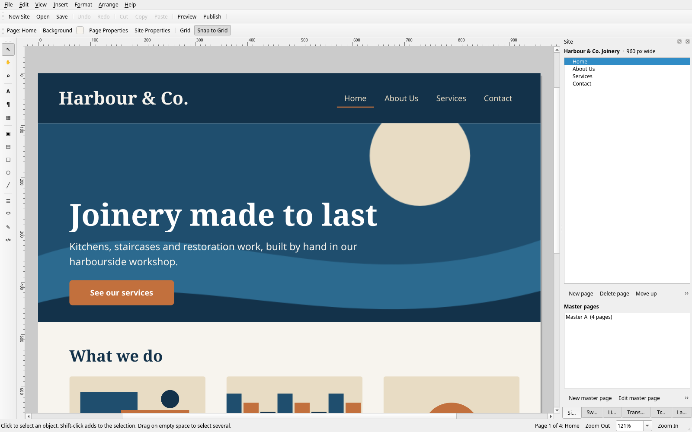
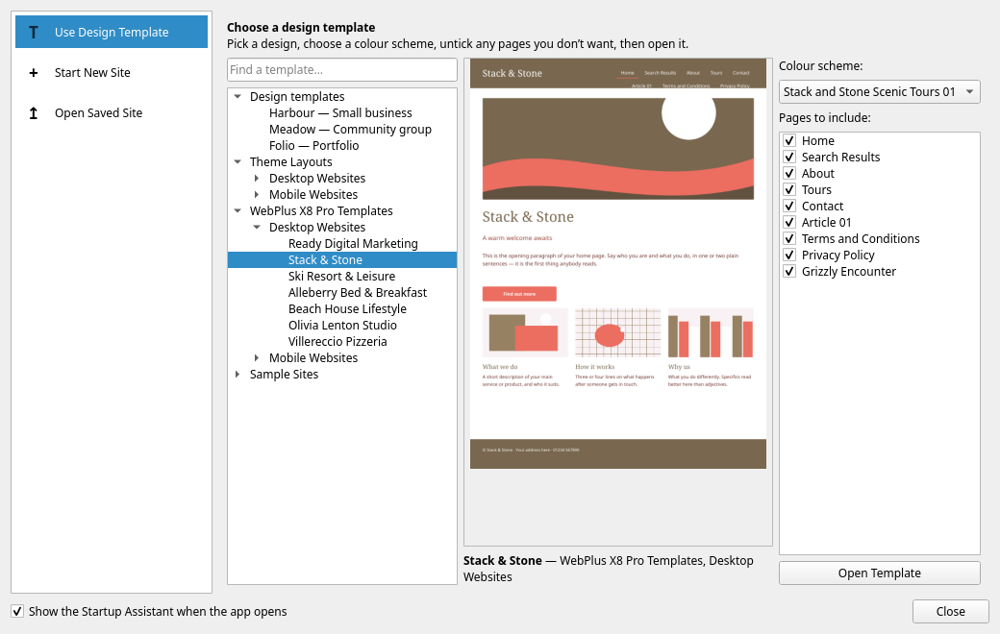

# just a... WEBcreator

A desktop website designer for Linux. Lay pages out freely, put the header and
the menu on a master page so every page shares them, preview in your browser,
and publish plain HTML to a folder you can upload anywhere. It follows your
desktop theme — Plasma colours, accent, fonts and icons.

<p align="center"></p>

The first of the **[just a... COLLECTION of apps](../../README.md)** — simple
applications for people who want to do what the excellent **ARTcraft** apps do
without learning everything new, and without needing the powerful, complicated
half. Every one of them is a ground-up recreation rather than a port or a fork.

## Install

```
sudo pacman -S --needed pyside6 python-beautifulsoup4 qt6-webengine
./install.sh
```

It is also in the Desktop Manager GUI, under **Apps ▸ just a… HANDFUL of apps
▸ Install**.

Then open **just a... WEBcreator** from the application menu, or run
`webcreator`. `./uninstall.sh` takes it off again; `--purge` also drops its
saved settings. Neither touches a site you made.

- `pyside6` is required. Use the distro package rather than pip, or the app
  will not pick up your desktop theme.
- `python-beautifulsoup4` is only needed for **File ▸ Import Website Folder…**
- `qt6-webengine` makes an imported page match the original layout exactly;
  without it, imports use a simpler flowing layout.

## What it does

| | |
|---|---|
| **New site** | From any of **92 templates**, or empty, through the Startup Assistant — see below |
| **Pages** | Add, delete, reorder, nest — the Site tab draws the tree to whatever depth it has |
| **Master pages** | Create, edit, and assign per page, so headers and menus are written once |
| **Objects** | Text, pictures, shapes, buttons, navigation bars, tables, forms, embedded HTML — drag, resize, rotate, align |
| **Import** | **File ▸ Import Website Folder…** reads a folder of HTML back into an editable site |
| **Open a WebPlus site** | **File ▸ Open Serif WebPlus Site…** (`Ctrl+Shift+O`) opens a Serif WebPlus `.wpp` — see below |
| **Publish** | Plain HTML + assets into a folder, previewable in your browser first |
| **Saves as** | `.webc`, a single file, registered as a file type so double-clicking one opens it |

## The 92 templates

<p align="center"></p>

Pick one on the left, pick a colour scheme, untick any pages you don't want,
open it. Three are this app's own designs. The other **89 follow the page trees
of the templates Serif WebPlus X8 shipped** — the page names, the filename each
page publishes as, which page hangs off which, and the colour schemes that
template's picker offered, with their twelve colours.

That catalogue lives in [`serif-templates.json`](serif-templates.json) and is
generated by `tools/webcreator_templates.py` in the Serif-for-Linux checkout,
off two mined TSVs. It holds **no artwork, no copy and no code of Serif's** —
nothing of theirs is redistributed here. Every page you get is drawn by this
file, in this app's own procedural artwork, in the scheme you picked. The
structure was the part worth recreating; the drawing is ours.

The whole set, as pictures, is on the
[site](https://janszafranski.github.io/just-a-collection-of-apps/webcreator.html#templates).

Three details the chooser gets right because the catalogue carries them:

- **Home cannot be unticked.** A site with no home page is not a site.
- **Unticking a page takes its sub-pages with it**, rather than leaving an
  orphan in the Site tree, the breadcrumb and every navigation bar.
- **Sub-pages nest under the right parent.** In four of the 89 — Bygone,
  Doodle, Eco, Quote — the nine Product sub-pages are stored *after* Terms &
  Conditions, because that is the order Serif saved the spreads in. The tree is
  walked by parent, not by position.

The app runs without the catalogue file: the chooser falls back to the three
designs and says nothing about it.

## Opening a Serif WebPlus site

`.wpp` publications made in Serif WebPlus open here and are editable: pages,
master pages, the site structure tree, and every object on every page. The
reading is not done by this app — it is done by `serif.webplus` in the
[Serif-for-Linux](https://github.com/janszafranski) checkout, which the app
finds on its own (`~/src/serif-linux`, `~/Documents/Development/serif-linux`, or
wherever `~/.local/bin/webwriter` points) and asks about once if it has moved.
Without that checkout every other feature still works; only this command asks
where to look.

**Your original is never written to.** A `.wpp` is opened read-only and this app
has no way to write Serif's format: the site arrives with no path, so **Save**
goes to **Save As** and a `.webc` file.

What does not come across is listed in the dialog rather than left to be found —
linked (not embedded) pictures, formats nothing on Linux opens, site-search
widgets. An object with nothing to embed keeps its size and position as an empty
placeholder, so the hole is visible and can be filled.

## Updates

**Help ▸ Check for Updates…** reads this file's copy of `webcreator.py` from
GitHub — repository, branch and path are in **Help ▸ Update Settings…**, and the
dialog shows the exact URL it will use. If the copy there has a higher
`VERSION`, a banner appears on the Startup Assistant and a button in the
toolbar; installing keeps the old version as `webcreator.py.bak` and offers to
restart.

To release one: raise `VERSION` in `webcreator.py`, commit, push to `main`
(this repository's default branch — the URL above is read from exactly there).
An update replaces this one file, so if `serif-templates.json` is not beside it
on that machine the app fetches it once, straight after updating.

Because the app can replace its own installed file, the installed copy can drift
from this one without anything here being edited.
`scripts/check-webcreator-sync.sh` in the desktop-manager repository compares
the installed copy with the one there and says which way to reconcile.

## Tests

```
cd apps/webcreator && python3 -m unittest test_webplus_import
```

25 tests, `unittest` rather than pytest because that is what Serif-for-Linux's
suite uses. They run against real publications and **skip, rather than fail**,
on a machine that does not have them or the reader checkout — so they are
honest on someone else's computer and strict on Jan's.

## Files

| File | What it is |
|---|---|
| `webcreator.py` | The whole app |
| `serif-templates.json` | The 89 page trees and their colour schemes |
| `install.sh` / `uninstall.sh` | Install or remove for the current user |
| `webcreator.desktop` | Application menu entry |
| `webcreator-mime.xml` | Registers `.webc` site files |
| `test_webplus_import.py` | The WebPlus-import tests |
